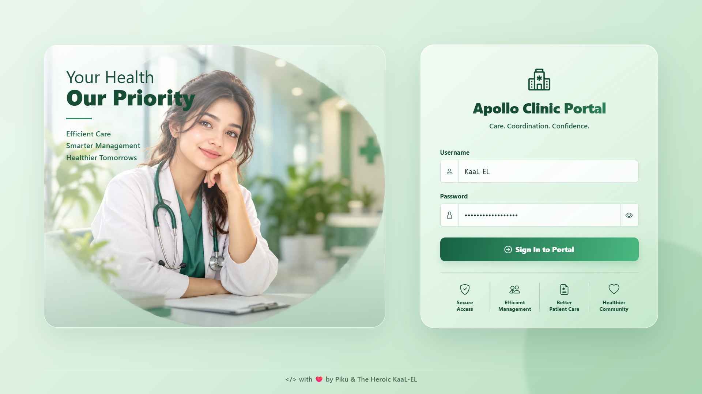

<div align="center">

# 🏥 Apollo Clinic Portal

### Hospital Management System

A Java-based web application to manage clinic operations, including doctors, patients, appointments, prescriptions, medical records & billing.

<br>


<br>


</div>

---

## 📌 About the Project

Apollo Clinic Portal is a Hospital Management System built using Java, Spring Boot and MySQL.

It provides separate workspaces for Admin, Receptionist and Doctor, making it easier to manage clinic activities and patient records through a single application.

## ✨ Features

- 🔐 **Role-Based Login** – Separate access for Admin, Receptionist and Doctor.
- 👨‍⚕️ **Doctor Management** – Manage doctor profiles and login accounts.
- 🧑 **Patient Management** – Add, update and manage patient information.
- 📅 **Appointment Management** – Schedule and manage appointments.
- 🩺 **Doctor Dashboard** – View today's appointments and assigned appointments.
- 📋 **Patient Medical Records** – Access patient history and prescription records.
- 💊 **Prescription Management** – Create, update and manage prescriptions.
- 🔄 **Follow-Up Management** – Schedule follow-up visits and maintain notes.
- 🧾 **Billing Management** – Manage bills and payment statuses.
- 📄 **PDF Generation** – Generate and download prescriptions and invoices.
- 💉 **Medicine Inventory** – Manage medicine stock and pricing.
- 🔎 **Search & Sorting** – Easily find and organize records.

## 👥 User Roles & Permissions

The application supports three roles with different permissions.

| Module | 👑 Admin | 🧑‍💼 Receptionist | 🩺 Doctor |
|---|:---:|:---:|:---:|
| Doctors | Full Access | View | View |
| Patients | Full Access | Full Access | Assigned Patients |
| Appointments | Full Access | Full Access | View Assigned |
| Prescriptions | Full Access | View + PDF | Own Prescriptions |
| Follow-Ups | Full Access | View | Own Follow-Ups |
| Billing | Full Access | View + PDF | ❌ |
| Medicines | Full Access | View | ❌ |
| Profile | Manage | — | Own Profile |

*Access is enforced through server-side role authorization.*

## 🛠️ Technology Stack

| Technology | Purpose |
|---|---|
| ☕ Java 21 | Backend Programming |
| 🍃 Spring Boot 3.3.4 | Application Framework |
| Spring MVC | Web Controllers & REST APIs |
| Spring Data JPA | Database Operations |
| Hibernate | Object Relational Mapping |
| 🐬 MySQL 8+ | Database |
| Thymeleaf | Server-Side Templates |
| HTML5, CSS3, JavaScript | Frontend |
| Bootstrap 5.3.2 | UI Components |
| OpenPDF 2.0.3 | PDF Generation |
| Gradle 8+ | Build & Dependency Management |

---

## 🗄️ Database Schema

The application uses MySQL for storing users, doctors, patients, appointments, prescriptions, follow-ups, bills and medicines.

The database schema and initial seed data are maintained in `schema.sql`.

### Entity Relationship Diagram


### Main Database Tables

| Table | Description |
|---|---|
| `users` | Login accounts and roles |
| `doctors` | Doctor information and account linking |
| `patients` | Patient details |
| `appointments` | Patient appointments |
| `prescriptions` | Prescription information |
| `followups` | Follow-up records |
| `bills` | Patient billing information |
| `medicines` | Medicine inventory |

---

## 🚀 Installation & Setup

### Requirements

- Java JDK 21
- MySQL 8+ or MariaDB
- Git
- Web Browser

*Gradle is already included through the Gradle Wrapper.*

### 1. Clone the Repository

```bash
git clone https://github.com/xKaaL-EL/Apollo-Clinic.git
cd Apollo-Clinic
```

### 2. Create the Database

Open MySQL and execute:

```sql
CREATE DATABASE IF NOT EXISTS hospital_db
CHARACTER SET utf8mb4
COLLATE utf8mb4_unicode_ci;
```

### 3. Configure Database

Open:

`src/main/resources/application.properties`

Configure your database username and password, or use environment variables:

```text
SPRING_DATASOURCE_URL
SPRING_DATASOURCE_USERNAME
SPRING_DATASOURCE_PASSWORD
```

### 4. Run the Application

**Windows:**

```powershell
.\gradlew.bat bootRun
```

**Linux / macOS:**

```bash
./gradlew bootRun
```

Once the application starts, open:

**http://localhost:8080/login**

---

## 🔑 Demo Login Credentials

Use the following accounts to explore the application.

| Role | Username | Password |
|---|---|---|
| 👑 Admin | `Piku` | `Piku@Apollo2026!` |
| 🧑‍💼 Receptionist | `KaaL-EL` | `KaaLEL@Apollo2026!` |
| 🩺 Doctor | `aarav.sharma` | `Aarav@Apollo2026!` |

Additional doctor accounts are available in the database seed data.

---

## 📂 Project Structure

```text
Apollo-Clinic/
│
├── gradle/
│   └── wrapper/
│
├── src/
│   ├── main/
│   │   ├── java/com/hospital/hms/
│   │   │   ├── config/          # Application configuration & security
│   │   │   ├── controller/      # API and web controllers
│   │   │   ├── dto/             # Data Transfer Objects
│   │   │   ├── exception/       # Exception handling
│   │   │   ├── model/           # Entities and enums
│   │   │   ├── repository/      # Database repositories
│   │   │   ├── service/         # Business logic
│   │   │   └── util/            # Utility classes and seeding
│   │   │
│   │   └── resources/
│   │       ├── static/
│   │       │   ├── css/
│   │       │   └── js/
│   │       ├── templates/       # HTML pages
│   │       ├── application.properties
│   │       └── schema.sql
│   │
│   └── test/                    # Application tests
│
├── ScreenShots/                 # Project screenshots
├── build.gradle
├── settings.gradle
├── gradlew
├── gradlew.bat
└── README.md
```

---


## Screenshots

### Login Page


### Doctor Management
.png)

### Patient Records
.png)

### Appointments
.png)

### Prescriptions
.png)

### Billing
.png)

### Medicine Inventory
.png)


## ❤️ Credits

<div align="center">

### Apollo Clinic Portal

**Care. Coordination. Convenience. — Bringing Better Healthcare Management Together 💚**

*</> with ❤️ by Piku & The Heroic KaaL-EL*

</div>
