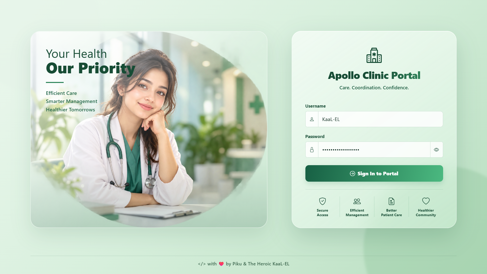

<div align="center">

# 🏥 Apollo Clinic Portal

**A practical clinic management system built with Java, Spring Boot and MySQL**

Manage patient records, appointments, prescriptions, follow-ups and billing from one place.

</div>

---

## About the project

Apollo Clinic Portal is a web application for handling the day-to-day administrative work of a clinic. It brings the main clinic modules into one dashboard, with login sessions, separate permissions for administrators and receptionists, and PDF generation for prescriptions and invoices.

This project uses Spring Boot for the backend, Thymeleaf and Bootstrap for the interface, and a relational database for storing clinic records.

## ✨ What it can do

- 📊 **Dashboard:** A sidebar-based interface with tables, forms, search and sorting.
- 🔐 **Login and roles:** Session-based authentication for `ADMIN` and `RECEPTIONIST` users.
- 🧑‍⚕️ **Doctors and patients:** Maintain clinic staff and patient records.
- 📅 **Appointments:** Create and manage appointment records.
- 💊 **Medicines:** Maintain medicine details and stock information.
- 📝 **Prescriptions:** Manage prescriptions and generate prescription PDFs.
- 🔁 **Follow-ups:** Keep follow-up records and notes.
- 🧾 **Billing:** Manage bills and see whether an invoice is paid or unpaid.
- 📄 **PDFs:** View or download prescription and invoice documents.
- 🔌 **REST API:** Endpoints for the main clinic modules.
- 🗄️ **Database options:** MySQL or MariaDB for local use, with H2 for tests when the test configuration enables it.

## 🧰 Built with

| Technology | Used for |
| --- | --- |
| Java 21 | Application code |
| Spring Boot 3.3.4 | Backend and application configuration |
| Spring Data JPA / Hibernate | Database access and entity mapping |
| MySQL 8+ / MariaDB | Main database |
| H2 | In-memory tests, when configured |
| Thymeleaf | Rendering the web pages |
| Bootstrap 5, CSS and JavaScript | Dashboard interface and interactions |
| OpenPDF | Prescription and invoice PDFs |
| Gradle Wrapper | Building and running the project |

## 💻 Before you start

Install these on your computer:

- **JDK 21**
- **MySQL 8+ or MariaDB**

You do not need to install Gradle separately. The project includes the Gradle Wrapper.

## 🚀 Run it on your computer

### 1. Get the project

Clone it using the URL of the repository:

```bash
git clone https://github.com/YOUR_USERNAME/apollo-clinic-portal.git
cd apollo-clinic-portal
```

### 2. Create the database

Start your MySQL or MariaDB server. Create the database using the name configured in your application.

For example, if the project is configured to use `hospital_db`, run:

```sql
CREATE DATABASE IF NOT EXISTS hospital_db
  CHARACTER SET utf8mb4
  COLLATE utf8mb4_unicode_ci;
```

**Keep the database name consistent.** Check `application.properties` and `schema.sql` before changing it; if your project uses a different name, use that name instead.

### 3. Set up database credentials 🔐

The repository should not contain your real database password. Configure these environment variables on your own computer:

```text
DB_URL=jdbc:mysql://localhost:3306/hospital_db
DB_USERNAME=your_mysql_username
DB_PASSWORD=your_mysql_password
```

In `src/main/resources/application.properties`, the datasource settings can read those variables like this:

```properties
spring.datasource.url=${DB_URL:jdbc:mysql://localhost:3306/hospital_db}
spring.datasource.username=${DB_USERNAME:root}
spring.datasource.password=${DB_PASSWORD}
```

Keep the rest of your existing configuration, including any SQL initialization and JPA settings the application needs.

> **About `.env`:** Spring Boot does not automatically load a `.env` file by default. You can set environment variables in your operating system or use a suitable local `.env` loader. Keep the real `.env` file out of Git. If you include `.env.example`, use placeholder values only.

### 4. Start the application

Open a terminal in the project root folder.

**Windows (PowerShell):**

```powershell
.\gradlew.bat bootRun
```

**Linux / macOS:**

```bash
./gradlew bootRun
```

Wait for the application to finish starting, then open this address in your browser:

```text
http://localhost:8080
```

Log in using an account configured in your local database or by the application's seeding logic. Do not rely on a default username or password unless you have confirmed that it is configured in your copy of the project.

## 👥 User roles and access

The application supports two roles. The table below summarises the intended access; the actual permissions are determined by the server-side authorization rules.

| Module | ADMIN | RECEPTIONIST |
| --- | --- | --- |
| Doctors | Full access | View only |
| Patients | Full access | Full access |
| Appointments | Full access | Full access |
| Follow-ups | Full access | Full access |
| Bills | Full access | View and PDF access |
| Prescriptions | Full access | View and PDF access |
| Medicines | Full access | Check the configured authorization rules |

The dashboard hides controls that a user is not allowed to use, and authorization is enforced on the server as well. In the source code, check `RoleAuthorizationInterceptor.java` for the implemented rules.

## 🔌 REST API

### Authentication

| Method | Endpoint | Purpose |
| --- | --- | --- |
| `POST` | `/api/auth/login` | Log in |
| `GET` | `/api/auth/me` | Get the current session user |
| `POST` | `/api/auth/logout` | Log out |

### Clinic modules

| Module | Base endpoint |
| --- | --- |
| Patients | `/api/patients` |
| Doctors | `/api/doctors` |
| Appointments | `/api/appointments` |
| Medicines | `/api/medicines` |
| Prescriptions | `/api/prescriptions` |
| Follow-ups | `/api/followups` |
| Bills | `/api/bills` |

The HTTP methods available for each module depend on its controller mappings and the logged-in user's permissions.

### 📄 Prescription and invoice PDFs

| Document | View PDF | Download PDF |
| --- | --- | --- |
| Prescription | `GET /api/prescriptions/{id}/pdf` | `GET /api/prescriptions/{id}/pdf/download` |
| Invoice | `GET /api/bills/{id}/pdf` | `GET /api/bills/{id}/pdf/download` |

Replace `{id}` with the relevant record ID.

## 🧪 Run tests and build

Run the test suite:

**Windows:**

```powershell
.\gradlew.bat test
```

**Linux / macOS:**

```bash
./gradlew test
```

Tests configured to use H2 can run without a MySQL server.

Build the project:

**Windows:**

```powershell
.\gradlew.bat build
```

**Linux / macOS:**

```bash
./gradlew build
```

The build output is written to the Gradle `build/` directory.

## 📂 Project layout

```text
apollo-clinic-portal/
├── gradle/
│   └── wrapper/
├── src/
│   ├── main/
│   │   ├── java/com/hospital/hms/
│   │   │   ├── controller/
│   │   │   ├── dto/
│   │   │   ├── exception/
│   │   │   ├── model/
│   │   │   ├── repository/
│   │   │   ├── service/
│   │   └── resources/
│   │       ├── static/
│   │       │   ├── css/portal.css
│   │       │   └── js/portal.js
│   │       ├── templates/
│   │       │   ├── login.html
│   │       │   └── dashboard.html
│   │       ├── application.properties
│   │       └── schema.sql
│   └── test/
├── .gitignore
├── build.gradle
├── settings.gradle
├── gradlew
├── gradlew.bat
└── README.md
```


## 📸 Screenshots

### Login Page



### Doctors Management

.png)

### Patients Management

.png)

### Billing Management

.png)

### Prescription Management

.png)

### Medicine Inventory

.png)

### Appointments Management

.png)


<div align="center">

**❤️ Apollo Clinic Portal**

*Built to make everyday clinic administration a little simpler.*

</div>
