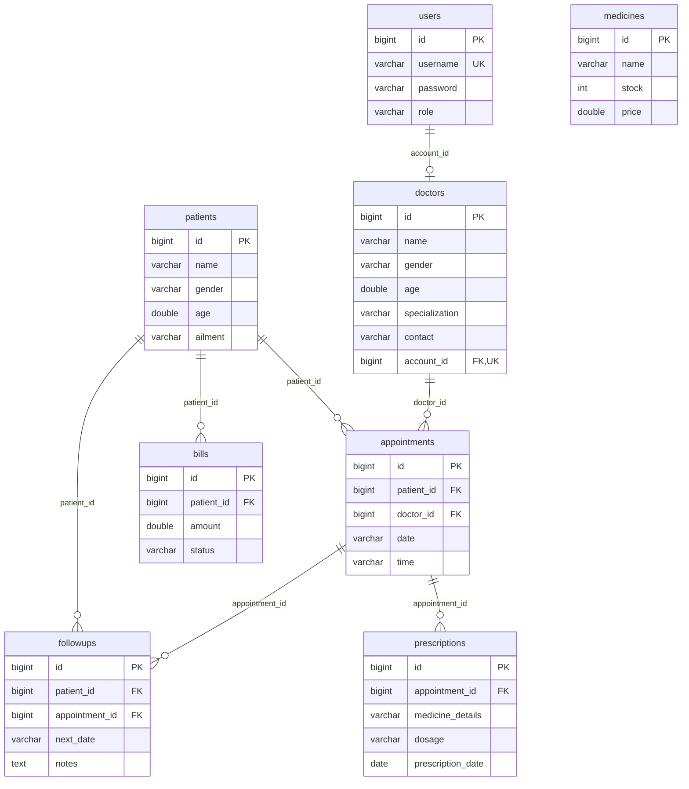

# Apollo Clinic Portal

Apollo Clinic Portal is a web-based clinic management system built with Java, Spring Boot, and MySQL. It helps clinics manage everyday administrative and clinical workflows, including patient records, appointments, doctor schedules, prescriptions, follow-ups, and billing. The app includes role-based access for administrators, receptionists, and doctors, along with PDF generation for prescriptions and invoices.

---

## Features

- **Role-Based Access Control**: Separate dashboards and permissions for `ADMIN`, `RECEPTIONIST`, and `DOCTOR` users.
- **Doctor Dashboard**: Doctors have their own workspace to view today's schedule (sorted chronologically), filter appointments by date/time, and update their profile.
- **Patient Medical Records**: Central view for patient info, appointment history, follow-up notes, and past prescriptions.
- **Prescription Management**: Create and track prescriptions. Doctors can view all past prescriptions for a patient while only editing or deleting their own.
- **PDF Generation**: Generate clean, branded PDFs for prescriptions and billing invoices with options to view inline or download.
- **Appointments & Follow-ups**: Book appointments, filter schedules, and tie follow-up visits and notes to specific appointments.
- **Billing & Invoices**: Create patient bills, track payment statuses (`PAID`, `UNPAID`, `OVERDUE`), and print invoices.
- **Medicine Inventory**: Keep track of available pharmacy stock and pricing.
- **Doctor Account Management**: Admins can register new doctor accounts and manage login credentials directly from the portal.

---

## User Roles & Permissions

| Module | ADMIN | RECEPTIONIST | DOCTOR |
| --- | --- | --- | --- |
| **Doctors** | Full access + Account creation | View only | View directory / Edit own profile |
| **Doctor Dashboard** | — | — | Full access |
| **Patients** | Full access | Full access | View assigned patients |
| **Appointments** | Full access | Full access | View assigned appointments |
| **Prescriptions** | Full access + PDF | View only + PDF | Create/Edit/Delete own + PDF |
| **Follow-Ups** | Full access | View only | Create/Edit/Delete own |
| **Bills & Invoices** | Full access + PDF | View only + PDF | No access |
| **Medicine Inventory**| Full access | View only | No access |

---

## Tech Stack

| Technology | Used For |
| --- | --- |
| Java 21 | Core application code |
| Spring Boot 3.3.4 | Backend framework (Spring MVC, Spring Data JPA) |
| MySQL 8+ / MariaDB | Main relational database |
| H2 Database | In-memory database used for automated tests |
| Thymeleaf | Server-side HTML page rendering |
| Bootstrap 5 & Icons | Responsive styling and UI components |
| OpenPDF | Generating prescription and invoice PDFs |
| Gradle Wrapper | Build tool and dependency management |

---

## Database Schema

The database schema and sample data are defined in `schema.sql`. It initializes all tables and seeds starter data automatically when the application starts up.



---

## Demo Accounts

The database comes pre-seeded with these demo users for testing:

| Role | Username | Password | Notes |
| --- | --- | --- | --- |
| **ADMIN** | `Piku` | `Piku@Apollo2026!` | Clinic administrator |
| **ADMIN (Fallback)** | `admin` | `1234` | Default fallback admin |
| **RECEPTIONIST** | `KaaL-EL` | `KaaLEL@Apollo2026!` | Front-desk staff |
| **DOCTOR** | `aarav.sharma` | `Aarav@Apollo2026!` | Dr. Aarav Sharma (Cardiology) |
| **DOCTOR** | `ananya.verma` | `Ananya@Apollo2026!` | Dr. Ananya Verma (Dermatology) |
| **DOCTOR** | `rohan.mehta` | `Rohan@Apollo2026!` | Dr. Rohan Mehta (Orthopedics) |

---

## Getting Started

### Prerequisites

- **Java JDK 21** or later
- **MySQL 8+** or **MariaDB**

### 1. Clone the repository

```bash
git clone https://github.com/xKaaL-EL/Apollo-Clinic.git
cd Apollo-Clinic
```

### 2. Create the database

Log in to your MySQL terminal and create the database:

```sql
CREATE DATABASE IF NOT EXISTS hospital_db
  CHARACTER SET utf8mb4
  COLLATE utf8mb4_unicode_ci;
```

### 3. Configure credentials

Update `src/main/resources/application.properties` with your MySQL username and password, or set these environment variables:

```bash
SPRING_DATASOURCE_URL=jdbc:mysql://localhost:3306/hospital_db?createDatabaseIfNotExist=true&useSSL=false&allowPublicKeyRetrieval=true&serverTimezone=UTC
SPRING_DATASOURCE_USERNAME=your_username
SPRING_DATASOURCE_PASSWORD=your_password
```

### 4. Run the application

Start the app using the Gradle wrapper:

**Windows (PowerShell):**
```powershell
.\gradlew.bat bootRun
```

**Linux / macOS:**
```bash
./gradlew bootRun
```

Once running, open `http://localhost:8080` in your browser and log in with any of the demo accounts above.

- Admin / Receptionist dashboard: `http://localhost:8080/dashboard`
- Doctor dashboard: `http://localhost:8080/doctor/dashboard`

---

## Testing & Building

Run tests (runs against an in-memory H2 database, no MySQL needed):

```bash
# Windows
.\gradlew.bat test

# Linux / macOS
./gradlew test
```

Build an executable JAR:

```bash
# Windows
.\gradlew.bat build

# Linux / macOS
./gradlew build
```

The output JAR will be placed in `build/libs/`.

---

## Screenshots

### Login Page


### Doctor Management
.png)

### Patient Records
.png)

### Appointments
.png)

### Prescriptions
.png)

### Billing
.png)

### Medicine Inventory
.png)
